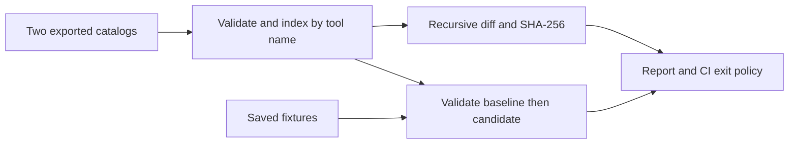

# Capability Delta

[](https://github.com/Nithinfgs/capability-delta/actions/workflows/ci.yml)
[](LICENSE)

**See which MCP contract changes break your saved examples before upgrading a server.**

Capability Delta compares two exported `tools/list` catalogs and validates saved arguments and structured outputs against both versions. It runs entirely offline; it never launches servers, executes tool calls, or needs credentials.

## Why this exists

A schema diff says something changed. A replay says which previously valid example no longer fits. Server maintainers and agent integration teams need both when reviewing upgrades. Description, annotation, output schema, and unknown metadata changes remain visible for human review.

Unlike runtime proxies and security scanners, this is a small CI contract check. It does not identify malicious descriptions or certify compatibility. See [research and alternatives](research/REPORT.md) and [design](docs/DESIGN.md).

## Features

- Deterministic JSON Pointer diffs, with before/after values in JSON output.
- Input **and output** fixture validation using JSON Schema Draft 2020-12.
- Rejects fixtures invalid against the baseline, avoiding misleading regression reports.
- Catalog fingerprints independent of object-key and tool ordering.
- Text, JSON, and escaped Markdown reports; configurable CI exit policy.
- Rejects duplicate names/keys, incomplete paginated exports, remote schema references, unsupported dialects, and oversized/deeply nested files.
- Reports removed output contracts as unverified rather than passed.

## Install

Requires Python 3.11 or later. No system services or API keys are needed.

```sh
git clone https://github.com/Nithinfgs/capability-delta.git
cd capability-delta
python3 -m venv .venv
# Windows: .venv\Scripts\activate
. .venv/bin/activate
python -m pip install .
```

The distribution is installed from this repository; no PyPI publication is implied.

## Quick start

```sh
capability-delta examples/before.json examples/after.json --fixtures examples/fixtures.json
```

This deliberately exits **1**: the candidate requires an additional input and narrows an output enum.

```text
Capability Delta: regression
1 changed tools; 2 fixtures
- changed: "find_notes"
  - changed "/inputSchema/required"
  - changed "/outputSchema/properties/status/enum"
- fixture "search-without-limit": regression
  - "/": required
- fixture "archived-note": regression
  - "/status": enum
Passing fixtures are examples, not proof of full compatibility.
```

```sh
# Machine-readable before/after values; continue even when drift is found
capability-delta examples/before.json examples/after.json --format json --fail-on never
# Block only demonstrated fixture regressions
capability-delta examples/before.json examples/after.json --fixtures examples/fixtures.json --fail-on regression
# Same catalog: exits 0
capability-delta examples/before.json examples/before.json --fixtures examples/fixtures.json
# Safe Markdown suitable for attaching to a review
capability-delta examples/before.json examples/after.json --format markdown --fail-on never > report.md
```

## Export format and configuration

Supply a JSON object with a `tools` array, or a JSON-RPC response with `result.tools`. Export catalogs through your existing authorized client. Collect **all pages** first; `nextCursor` is rejected when non-null. Compare the same server, authentication scope, and feature configuration. The CLI cannot establish server identity from these files.

Each tool must have a unique `name` and an `inputSchema` with `type: "object"`. Optional `outputSchema` follows the same rule. JSON Schema Draft 2020-12 is supported, including document-local `$ref`. Remote references, `$id`, and other dialects are rejected. `format` is treated as an annotation, matching the validator default; custom keywords are not enforced.

Fixtures are a JSON array:

```json
[{"id":"search-without-limit","tool":"find_notes","kind":"input","value":{"query":"release"}}]
```

Use `kind: "output"` for the actual `structuredContent` object, **not** the surrounding `tools/call` response. Sanitize saved data before committing it. Reports omit fixture values and validator messages, but JSON diffs contain catalog metadata and schema values.

There is no hidden config or environment-variable behavior. Flags configure each run:

| Flag | Values | Default |
|---|---|---|
| `--fixtures` | JSON file | no fixtures |
| `--format` | text, json, markdown | text |
| `--fail-on` | change, regression, never | change |

Exit codes: **0** policy passed, **1** policy failed, **2** malformed/unsupported input or processing failure. `--fail-on never` never suppresses processing errors. A changed catalog with passing fixtures is `review`; matching catalogs are `unchanged`; a failed previously valid fixture is `regression`.

## Architecture and stack

Python, `jsonschema`, and its `referencing` registry. No network transport is included.



`core.py` handles input validation, diffs, and evidence; `cli.py` handles reporting and exit policies. `tests/` exercises the public API and installed CLI. `examples/` contains synthetic, executable fixtures.

## Development and testing

```sh
python -m pip install -e '.[dev]'
python -m pytest -q
ruff check .
ruff format --check .
mypy src
python -m build
pip-audit
```

CI runs tests on Linux, macOS, and Windows with Python 3.11 and 3.13; a separate quality job runs lint, formatting, types, and package build. See [validation evidence](docs/VALIDATION.md) for actual local results.

## Limits

Passing finite examples cannot prove schema equivalence or all-call compatibility. Output replay tests whether **old captured output** still meets the new contract; it does not predict new server behavior. Array ordering changes are reported, even for semantically unordered `required` or `enum` arrays. Annotations are untrusted metadata, not enforced permissions. Files are limited to 5 MiB and 64 nesting levels, but complex schemas/regular expressions can still consume resources; run untrusted catalogs in a resource-limited CI worker. Nothing here is a sandbox, firewall, MCP client, or full protocol validator.

## Roadmap

1. Consumer-side output expectations alongside provider contracts.
2. Coverage reporting for tools without input/output examples.
3. Semantics-aware normalization of `required` and `enum` arrays.
4. Reviewed baseline bundles with explicit server/scope identity.
5. Optional, separately permissioned catalog export adapters.

Contributions are welcome; see [CONTRIBUTING.md](CONTRIBUTING.md). Licensed under [MIT](LICENSE).
